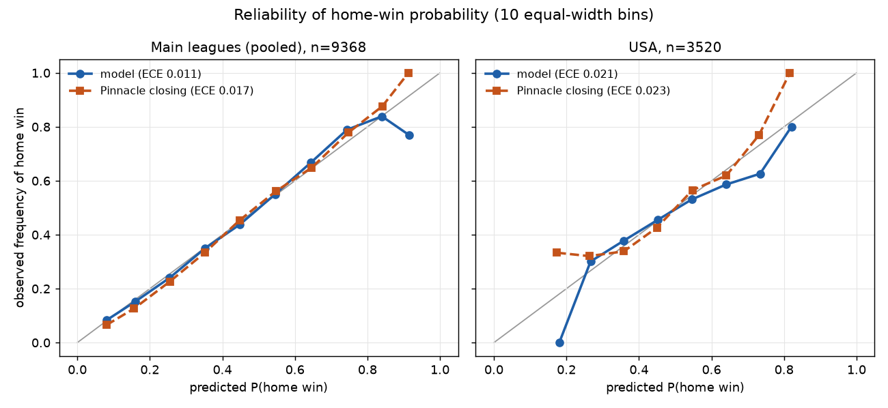

# football-odds-model

A prototype pipeline that turns public football results and odds into pre-match probabilities, checks them against Pinnacle, and runs a simple, honest bet simulation. It is a research prototype: nothing here is, or claims to be, in live use.

## Data
- Source: football-data.co.uk (snapshot 2026-11-06, raw files kept read-only with a SHA-256 manifest). 20836 matches from 2017-03-04 to 2026-11-03.
- Main leagues, seasons 2122-2526: I1 (Serie A), I2 (Serie B), E0 (Premier League), SP1 (La Liga), D1 (Bundesliga), F1 (Ligue 1), N1 (Eredivisie), P1 (Primeira Liga). Extra leagues: USA (MLS), DNK (Denmark), SWE (Sweden) (USA 2017-2026, SWE 2021-2026, DNK 2021/2022-2025/2026).
- Pinnacle outage: in the 2025/26 data the Pinnacle feed degrades and then disappears (see `reports/phase1/pinnacle_reliability.md`). A fixed reference-price rule (`config/reference_price.yaml`) gives a match a Pinnacle reference only if its month is before the league cutoff month (E0: 2026-01, I1: 2026-01, SP1: 2026-01, D1: 2026-01, F1: 2026-01, P1: 2026-01, I2: 2025-10, N1: 2025-10, DNK: 2025-11, SWE: 2025-08, USA: 2025-08), the league-month is not flagged in the diagnostics, and all Pinnacle prices of that market and timing are present and above 1.0. Average odds never replace Pinnacle. No match is dropped; it only loses the reference.
- Limit: the USA, DNK and SWE files contain closing 1X2 odds only (no pre-match odds, totals or Asian handicap), so for them the model is compared with Pinnacle closing only.

## Method
- No look-ahead: every prediction uses only matches strictly before the match date; validation is walk-forward only; closing odds are never model inputs.
- Time-decayed Dixon-Coles goal model (xi = 0.0019 per day, L2 shrinkage 3.0), one model per league, refitted every 7 days. The first season of each league is training only: 17192 predictions.
- All markets (1X2, over/under 2.5, Asian handicap probabilities, both teams to score) come from the same score matrix.

## Forecast quality vs Pinnacle (separate from betting)
Scored on the same matches as the benchmark; diff = model minus benchmark, negative is better for the model; CI from a paired bootstrap over matches (B = 2000).

| benchmark | scope | n | model log loss | benchmark log loss | diff log loss [CI] | diff Brier [CI] | diff RPS [CI] |
|---|---|---|---|---|---|---|---|
| pin_close | pooled_main | 9368 | 0.9867 | 0.9617 | 0.0250 [0.0215, 0.0285] | 0.0165 [0.0142, 0.0190] | 0.0076 [0.0065, 0.0087] |
| pin_pre | pooled_main | 9364 | 0.9868 | 0.9656 | 0.0211 [0.0181, 0.0242] | 0.0140 [0.0118, 0.0162] | 0.0064 [0.0054, 0.0074] |
| pin_close | USA | 3520 | 1.0380 | 1.0165 | 0.0215 [0.0150, 0.0278] | 0.0148 [0.0102, 0.0192] | 0.0069 [0.0048, 0.0090] |
| pin_close | DNK | 656 | 1.0345 | 1.0081 | 0.0263 [0.0141, 0.0395] | 0.0175 [0.0090, 0.0267] | 0.0084 [0.0044, 0.0126] |
| pin_close | SWE | 862 | 1.0059 | 0.9820 | 0.0239 [0.0114, 0.0363] | 0.0166 [0.0081, 0.0250] | 0.0077 [0.0037, 0.0117] |

On the main leagues the model's 1X2 log loss against Pinnacle closing is higher (worse) than the benchmark (difference 0.0250, CI [0.0215, 0.0285]). For over/under 2.5 on the main leagues the log-loss difference is 0.0128 [0.0098, 0.0158].

Expected calibration error, p_home: Main leagues (pooled) model 0.0112; Main leagues (pooled) Pinnacle closing 0.0173; USA model 0.0207; USA Pinnacle closing 0.0233.

Blend: p = w * model + (1 - w) * Pinnacle pre fair, with w chosen per league on earlier evaluated seasons only; w is above 0 in 3 of 24 league-seasons that have a blend (`reports/phase3/blend_weights.csv`). Because w is 0 in most league-seasons, the blend is mostly the Pinnacle pre-match fair price itself; its bets compare that price with the best Max pre-match price, so its CLV should not be read as model skill.

## Bet simulation (main leagues, pre-match information only; separate from forecast quality)
Decision from model (or blend) probabilities and Max PRE odds only; Pinnacle closing is used afterwards for CLV. One flat-stake bet per match and market on the largest edge; outcomes above 10 excluded; only matches with a Pinnacle closing reference. Thresholds [0.02, 0.05, 0.1] were fixed in advance and all are shown. Pooled main leagues:

| market | signal | threshold | bets | ROI [CI] | mean CLV [CI] | CLV bets | share beating close | max drawdown |
|---|---|---|---|---|---|---|---|---|
| 1x2 | blend | 0.0200 | 2067 | -0.0275 [-0.1136, 0.0546] | 0.0254 [0.0209, 0.0303] | 2067 | 0.6512 | 94.5000 |
| 1x2 | blend | 0.0500 | 649 | -0.0592 [-0.2291, 0.1216] | 0.0358 [0.0252, 0.0465] | 649 | 0.6225 | 70.1600 |
| 1x2 | blend | 0.1000 | 140 | 0.0103 [-0.3974, 0.4378] | 0.0558 [0.0229, 0.0932] | 140 | 0.6500 | 36.5800 |
| 1x2 | model | 0.0200 | 8584 | -0.0833 [-0.1200, -0.0473] | -0.0130 [-0.0152, -0.0107] | 8584 | 0.4328 | 731.1500 |
| 1x2 | model | 0.0500 | 7494 | -0.1004 [-0.1410, -0.0624] | -0.0131 [-0.0155, -0.0108] | 7494 | 0.4321 | 773.5400 |
| 1x2 | model | 0.1000 | 5717 | -0.1106 [-0.1555, -0.0633] | -0.0124 [-0.0153, -0.0095] | 5717 | 0.4291 | 637.3800 |
| ah | model | 0.0200 | 7525 | -0.0293 [-0.0500, -0.0086] | -0.0141 [-0.0155, -0.0126] | 4711 | 0.3800 | 229.3100 |
| ah | model | 0.0500 | 5982 | -0.0265 [-0.0494, -0.0052] | -0.0133 [-0.0150, -0.0117] | 3730 | 0.3863 | 171.2150 |
| ah | model | 0.1000 | 3828 | -0.0312 [-0.0603, -0.0027] | -0.0114 [-0.0135, -0.0093] | 2373 | 0.4037 | 126.1300 |
| ou25 | model | 0.0200 | 7026 | -0.0322 [-0.0571, -0.0083] | -0.0152 [-0.0166, -0.0137] | 7026 | 0.3847 | 239.9000 |
| ou25 | model | 0.0500 | 5440 | -0.0341 [-0.0639, -0.0067] | -0.0148 [-0.0166, -0.0130] | 5440 | 0.3886 | 214.4600 |
| ou25 | model | 0.1000 | 3270 | -0.0346 [-0.0721, 0.0031] | -0.0143 [-0.0166, -0.0119] | 3270 | 0.3988 | 140.6700 |

Reference: the mean CLV of an uninformed bet on every 1X2 outcome at Max pre odds is -0.0054 (28101 outcomes); the model-signal cells above should be read against this value, not against zero.

Caveats: Max odds are the best price across many bookmakers and may not be obtainable at size. Several thresholds, markets and signals are tested, so a single positive cell is not evidence. ROI intervals are bootstrap intervals over bets and ignore dependence between bets. Full tables: `reports/phase3/bet_simulation.md`.

## Limits and next steps
- No team news, lineups or expected-goals data; results-only model.
- The Pinnacle outage removes the benchmark for the most recent months of the main leagues.
- MLS, Danish and Swedish data lack pre-match odds: a pre-match odds source for them is the first thing to add.
- Next: expected goals, lineups, and a longer clean history of Pinnacle pre-match odds.

Reproduce: see `diary.md` and the scripts in `scripts/` (`run_phase1a.py`, `run_phase1b.py`, `run_phase2.py`, `run_phase3.py`, `build_readme.py`), run with `PYTHONNOUSERSITE=1 conda run -n fbmodel python <script>`.
