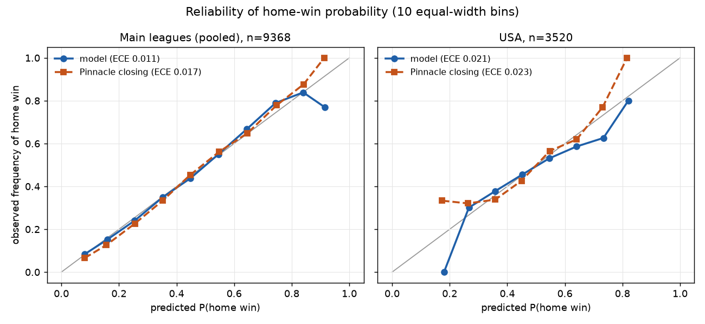

# Phase 3 - Forecast quality (no betting here)

Model: walk-forward Dixon-Coles (Phase 2), 17192 predictions joined to matches. Benchmarks: Pinnacle proportional-devigged fair probabilities, closing where ref_source_<market>_close == pin, pre where ref_source_<market>_pre == pin. Model and benchmark are always scored on the SAME matches. diff = model minus benchmark (negative = model better for all three losses). CI: paired bootstrap over matches, B=2000, seed 42, level 0.95. USA, DNK and SWE have a closing benchmark only (declared limit: no pre-match odds in the source); O/U 2.5 is evaluated for the main leagues only.

## 1X2 against Pinnacle closing

| scope | metric | n | model | benchmark_value | diff_model_minus_bench | ci_low | ci_high |
|---|---|---|---|---|---|---|---|
| I1 | log_loss | 1306 | 0.9915 | 0.9683 | 0.0232 | 0.0146 | 0.0318 |
| I1 | brier | 1306 | 0.5927 | 0.5777 | 0.0150 | 0.0091 | 0.0209 |
| I1 | rps | 1306 | 0.1962 | 0.1893 | 0.0069 | 0.0043 | 0.0095 |
| I2 | log_loss | 1196 | 1.0826 | 1.0526 | 0.0300 | 0.0193 | 0.0404 |
| I2 | brier | 1196 | 0.6554 | 0.6345 | 0.0209 | 0.0134 | 0.0280 |
| I2 | rps | 1196 | 0.2164 | 0.2071 | 0.0092 | 0.0057 | 0.0125 |
| E0 | log_loss | 1326 | 0.9715 | 0.9466 | 0.0249 | 0.0148 | 0.0347 |
| E0 | brier | 1326 | 0.5770 | 0.5602 | 0.0168 | 0.0100 | 0.0236 |
| E0 | rps | 1326 | 0.2009 | 0.1928 | 0.0081 | 0.0049 | 0.0113 |
| SP1 | log_loss | 1310 | 0.9776 | 0.9557 | 0.0219 | 0.0129 | 0.0306 |
| SP1 | brier | 1310 | 0.5811 | 0.5672 | 0.0139 | 0.0078 | 0.0198 |
| SP1 | rps | 1310 | 0.1967 | 0.1901 | 0.0065 | 0.0038 | 0.0092 |
| D1 | log_loss | 1053 | 0.9981 | 0.9716 | 0.0265 | 0.0162 | 0.0371 |
| D1 | brier | 1053 | 0.5965 | 0.5775 | 0.0190 | 0.0119 | 0.0263 |
| D1 | rps | 1053 | 0.2045 | 0.1963 | 0.0083 | 0.0049 | 0.0116 |
| F1 | log_loss | 1136 | 0.9966 | 0.9743 | 0.0223 | 0.0129 | 0.0319 |
| F1 | brier | 1136 | 0.5944 | 0.5800 | 0.0144 | 0.0079 | 0.0209 |
| F1 | rps | 1136 | 0.2080 | 0.2008 | 0.0072 | 0.0042 | 0.0102 |
| N1 | log_loss | 981 | 0.9416 | 0.9171 | 0.0244 | 0.0132 | 0.0356 |
| N1 | brier | 981 | 0.5587 | 0.5426 | 0.0162 | 0.0085 | 0.0239 |
| N1 | rps | 981 | 0.1882 | 0.1805 | 0.0077 | 0.0043 | 0.0111 |
| P1 | log_loss | 1060 | 0.9223 | 0.8952 | 0.0272 | 0.0165 | 0.0370 |
| P1 | brier | 1060 | 0.5414 | 0.5250 | 0.0164 | 0.0095 | 0.0228 |
| P1 | rps | 1060 | 0.1835 | 0.1767 | 0.0068 | 0.0038 | 0.0098 |
| USA | log_loss | 3520 | 1.0380 | 1.0165 | 0.0215 | 0.0150 | 0.0278 |
| USA | brier | 3520 | 0.6236 | 0.6088 | 0.0148 | 0.0102 | 0.0192 |
| USA | rps | 3520 | 0.2178 | 0.2108 | 0.0069 | 0.0048 | 0.0090 |
| DNK | log_loss | 656 | 1.0345 | 1.0081 | 0.0263 | 0.0141 | 0.0395 |
| DNK | brier | 656 | 0.6207 | 0.6032 | 0.0175 | 0.0090 | 0.0267 |
| DNK | rps | 656 | 0.2139 | 0.2055 | 0.0084 | 0.0044 | 0.0126 |
| SWE | log_loss | 862 | 1.0059 | 0.9820 | 0.0239 | 0.0114 | 0.0363 |
| SWE | brier | 862 | 0.6010 | 0.5844 | 0.0166 | 0.0081 | 0.0250 |
| SWE | rps | 862 | 0.2148 | 0.2071 | 0.0077 | 0.0037 | 0.0117 |
| pooled_main | log_loss | 9368 | 0.9867 | 0.9617 | 0.0250 | 0.0215 | 0.0285 |
| pooled_main | brier | 9368 | 0.5881 | 0.5716 | 0.0165 | 0.0142 | 0.0190 |
| pooled_main | rps | 9368 | 0.1996 | 0.1920 | 0.0076 | 0.0065 | 0.0087 |
| pooled_extra | log_loss | 5038 | 1.0320 | 1.0095 | 0.0225 | 0.0174 | 0.0277 |
| pooled_extra | brier | 5038 | 0.6194 | 0.6039 | 0.0155 | 0.0119 | 0.0191 |
| pooled_extra | rps | 5038 | 0.2168 | 0.2095 | 0.0073 | 0.0055 | 0.0090 |
| pooled_all | log_loss | 14406 | 1.0025 | 0.9784 | 0.0241 | 0.0213 | 0.0270 |
| pooled_all | brier | 14406 | 0.5991 | 0.5829 | 0.0161 | 0.0142 | 0.0182 |
| pooled_all | rps | 14406 | 0.2056 | 0.1981 | 0.0075 | 0.0065 | 0.0084 |

## 1X2 against Pinnacle pre-match (main leagues)

| scope | metric | n | model | benchmark_value | diff_model_minus_bench | ci_low | ci_high |
|---|---|---|---|---|---|---|---|
| I1 | log_loss | 1306 | 0.9915 | 0.9700 | 0.0216 | 0.0133 | 0.0294 |
| I1 | brier | 1306 | 0.5927 | 0.5784 | 0.0143 | 0.0086 | 0.0197 |
| I1 | rps | 1306 | 0.1962 | 0.1896 | 0.0066 | 0.0041 | 0.0091 |
| I2 | log_loss | 1192 | 1.0836 | 1.0589 | 0.0247 | 0.0149 | 0.0342 |
| I2 | brier | 1192 | 0.6561 | 0.6387 | 0.0173 | 0.0106 | 0.0239 |
| I2 | rps | 1192 | 0.2166 | 0.2092 | 0.0075 | 0.0044 | 0.0106 |
| E0 | log_loss | 1326 | 0.9715 | 0.9516 | 0.0200 | 0.0104 | 0.0288 |
| E0 | brier | 1326 | 0.5770 | 0.5641 | 0.0129 | 0.0063 | 0.0191 |
| E0 | rps | 1326 | 0.2009 | 0.1946 | 0.0063 | 0.0032 | 0.0093 |
| SP1 | log_loss | 1311 | 0.9778 | 0.9579 | 0.0199 | 0.0123 | 0.0276 |
| SP1 | brier | 1311 | 0.5812 | 0.5685 | 0.0128 | 0.0075 | 0.0181 |
| SP1 | rps | 1311 | 0.1966 | 0.1907 | 0.0059 | 0.0035 | 0.0083 |
| D1 | log_loss | 1053 | 0.9981 | 0.9725 | 0.0256 | 0.0160 | 0.0353 |
| D1 | brier | 1053 | 0.5965 | 0.5783 | 0.0182 | 0.0114 | 0.0248 |
| D1 | rps | 1053 | 0.2045 | 0.1963 | 0.0082 | 0.0052 | 0.0112 |
| F1 | log_loss | 1136 | 0.9966 | 0.9749 | 0.0217 | 0.0132 | 0.0300 |
| F1 | brier | 1136 | 0.5944 | 0.5800 | 0.0144 | 0.0085 | 0.0200 |
| F1 | rps | 1136 | 0.2080 | 0.2011 | 0.0069 | 0.0042 | 0.0095 |
| N1 | log_loss | 981 | 0.9416 | 0.9253 | 0.0163 | 0.0063 | 0.0259 |
| N1 | brier | 981 | 0.5587 | 0.5480 | 0.0107 | 0.0040 | 0.0172 |
| N1 | rps | 981 | 0.1882 | 0.1832 | 0.0051 | 0.0019 | 0.0081 |
| P1 | log_loss | 1059 | 0.9221 | 0.9032 | 0.0189 | 0.0103 | 0.0273 |
| P1 | brier | 1059 | 0.5412 | 0.5302 | 0.0110 | 0.0053 | 0.0167 |
| P1 | rps | 1059 | 0.1834 | 0.1791 | 0.0043 | 0.0017 | 0.0068 |
| pooled_main | log_loss | 9364 | 0.9868 | 0.9656 | 0.0211 | 0.0181 | 0.0242 |
| pooled_main | brier | 9364 | 0.5882 | 0.5742 | 0.0140 | 0.0118 | 0.0162 |
| pooled_main | rps | 9364 | 0.1996 | 0.1932 | 0.0064 | 0.0054 | 0.0074 |

## O/U 2.5 against Pinnacle closing (main leagues)

| scope | metric | n | model | benchmark_value | diff_model_minus_bench | ci_low | ci_high |
|---|---|---|---|---|---|---|---|
| I1 | log_loss | 1306 | 0.6898 | 0.6791 | 0.0107 | 0.0038 | 0.0180 |
| I1 | brier | 1306 | 0.2483 | 0.2430 | 0.0052 | 0.0019 | 0.0088 |
| I2 | log_loss | 1196 | 0.7065 | 0.6906 | 0.0159 | 0.0075 | 0.0241 |
| I2 | brier | 1196 | 0.2561 | 0.2486 | 0.0075 | 0.0034 | 0.0114 |
| E0 | log_loss | 1315 | 0.6733 | 0.6661 | 0.0072 | -0.0002 | 0.0149 |
| E0 | brier | 1315 | 0.2401 | 0.2368 | 0.0033 | -0.0002 | 0.0070 |
| SP1 | log_loss | 1308 | 0.6757 | 0.6625 | 0.0132 | 0.0054 | 0.0212 |
| SP1 | brier | 1308 | 0.2413 | 0.2349 | 0.0064 | 0.0026 | 0.0102 |
| D1 | log_loss | 1013 | 0.6657 | 0.6532 | 0.0125 | 0.0034 | 0.0211 |
| D1 | brier | 1013 | 0.2362 | 0.2306 | 0.0057 | 0.0015 | 0.0097 |
| F1 | log_loss | 1130 | 0.6871 | 0.6746 | 0.0124 | 0.0037 | 0.0213 |
| F1 | brier | 1130 | 0.2468 | 0.2409 | 0.0060 | 0.0017 | 0.0103 |
| N1 | log_loss | 981 | 0.6761 | 0.6613 | 0.0147 | 0.0063 | 0.0237 |
| N1 | brier | 981 | 0.2415 | 0.2347 | 0.0068 | 0.0028 | 0.0110 |
| P1 | log_loss | 1060 | 0.6824 | 0.6646 | 0.0177 | 0.0091 | 0.0266 |
| P1 | brier | 1060 | 0.2445 | 0.2361 | 0.0084 | 0.0043 | 0.0126 |
| pooled_main | log_loss | 9309 | 0.6824 | 0.6695 | 0.0128 | 0.0098 | 0.0158 |
| pooled_main | brier | 9309 | 0.2445 | 0.2384 | 0.0061 | 0.0046 | 0.0074 |

## O/U 2.5 against Pinnacle pre-match (main leagues)

| scope | metric | n | model | benchmark_value | diff_model_minus_bench | ci_low | ci_high |
|---|---|---|---|---|---|---|---|
| I1 | log_loss | 1305 | 0.6898 | 0.6815 | 0.0083 | 0.0016 | 0.0145 |
| I1 | brier | 1305 | 0.2482 | 0.2442 | 0.0040 | 0.0009 | 0.0070 |
| I2 | log_loss | 1192 | 0.7058 | 0.6900 | 0.0159 | 0.0075 | 0.0245 |
| I2 | brier | 1192 | 0.2558 | 0.2484 | 0.0074 | 0.0034 | 0.0115 |
| E0 | log_loss | 1314 | 0.6735 | 0.6677 | 0.0058 | -0.0007 | 0.0129 |
| E0 | brier | 1314 | 0.2402 | 0.2376 | 0.0027 | -0.0005 | 0.0061 |
| SP1 | log_loss | 1307 | 0.6760 | 0.6654 | 0.0106 | 0.0027 | 0.0182 |
| SP1 | brier | 1307 | 0.2414 | 0.2363 | 0.0051 | 0.0013 | 0.0087 |
| D1 | log_loss | 1009 | 0.6657 | 0.6572 | 0.0085 | 0.0003 | 0.0166 |
| D1 | brier | 1009 | 0.2363 | 0.2324 | 0.0038 | 0.0001 | 0.0076 |
| F1 | log_loss | 1128 | 0.6867 | 0.6778 | 0.0089 | 0.0010 | 0.0166 |
| F1 | brier | 1128 | 0.2467 | 0.2424 | 0.0043 | 0.0004 | 0.0080 |
| N1 | log_loss | 981 | 0.6761 | 0.6631 | 0.0129 | 0.0046 | 0.0219 |
| N1 | brier | 981 | 0.2415 | 0.2354 | 0.0061 | 0.0021 | 0.0102 |
| P1 | log_loss | 1059 | 0.6825 | 0.6674 | 0.0151 | 0.0073 | 0.0230 |
| P1 | brier | 1059 | 0.2446 | 0.2374 | 0.0072 | 0.0035 | 0.0109 |
| pooled_main | log_loss | 9295 | 0.6823 | 0.6717 | 0.0106 | 0.0079 | 0.0134 |
| pooled_main | brier | 9295 | 0.2445 | 0.2395 | 0.0050 | 0.0037 | 0.0063 |

## Calibration of p_home

Equal-width bins; the outermost bins hold few matches (counts in calibration_p_home.csv) and are noisy. ECE = sum over bins of (n_b / N) * |observed - predicted|.

| scope | forecast | n | ece |
|---|---|---|---|
| Main leagues (pooled) | model | 9368 | 0.0112 |
| Main leagues (pooled) | Pinnacle closing | 9368 | 0.0173 |
| USA | model | 3520 | 0.0207 |
| USA | Pinnacle closing | 3520 | 0.0233 |

## Blend with Pinnacle pre (main leagues)
p_blend = w * model + (1 - w) * Pinnacle pre fair, w per league and season chosen on 1X2 log loss over all EARLIER evaluated seasons of that league only (the first evaluated season has no blend). Weights:

| league | season | w | n_fit |
|---|---|---|---|
| D1 | 2223 |  | 0 |
| D1 | 2324 | 0.13 | 306 |
| D1 | 2425 | 0.00 | 612 |
| D1 | 2526 | 0.00 | 918 |
| E0 | 2223 |  | 0 |
| E0 | 2324 | 0.00 | 380 |
| E0 | 2425 | 0.00 | 760 |
| E0 | 2526 | 0.00 | 1140 |
| F1 | 2223 |  | 0 |
| F1 | 2324 | 0.00 | 380 |
| F1 | 2425 | 0.00 | 686 |
| F1 | 2526 | 0.00 | 992 |
| I1 | 2223 |  | 0 |
| I1 | 2324 | 0.00 | 380 |
| I1 | 2425 | 0.00 | 760 |
| I1 | 2526 | 0.00 | 1140 |
| I2 | 2223 |  | 0 |
| I2 | 2324 | 0.00 | 377 |
| I2 | 2425 | 0.00 | 756 |
| I2 | 2526 | 0.00 | 1136 |
| N1 | 2223 |  | 0 |
| N1 | 2324 | 0.27 | 306 |
| N1 | 2425 | 0.05 | 612 |
| N1 | 2526 | 0.00 | 918 |
| P1 | 2223 |  | 0 |
| P1 | 2324 | 0.00 | 306 |
| P1 | 2425 | 0.00 | 611 |
| P1 | 2526 | 0.00 | 917 |
| SP1 | 2223 |  | 0 |
| SP1 | 2324 | 0.00 | 380 |
| SP1 | 2425 | 0.00 | 760 |
| SP1 | 2526 | 0.00 | 1140 |

Scores of the blend on the same matches (diff = blend minus comparator):

| benchmark | scope | metric | n | model | benchmark_value | diff_model_minus_bench | ci_low | ci_high |
|---|---|---|---|---|---|---|---|---|
| blend_vs_pin_pre | I1 | log_loss | 926 | 0.9661 | 0.9661 | 0.0000 | -0.0000 | -0.0000 |
| blend_vs_pin_pre | I1 | brier | 926 | 0.5758 | 0.5758 | 0.0000 | -0.0000 | 0.0000 |
| blend_vs_pin_pre | I1 | rps | 926 | 0.1868 | 0.1868 | 0.0000 | -0.0000 | 0.0000 |
| blend_vs_model | I1 | log_loss | 926 | 0.9661 | 0.9898 | -0.0237 | -0.0334 | -0.0146 |
| blend_vs_model | I1 | brier | 926 | 0.5758 | 0.5916 | -0.0157 | -0.0224 | -0.0093 |
| blend_vs_model | I1 | rps | 926 | 0.1868 | 0.1942 | -0.0074 | -0.0104 | -0.0046 |
| blend_vs_pin_pre | I2 | log_loss | 815 | 1.0555 | 1.0555 | -0.0000 | -0.0000 | -0.0000 |
| blend_vs_pin_pre | I2 | brier | 815 | 0.6369 | 0.6369 | 0.0000 | -0.0000 | 0.0000 |
| blend_vs_pin_pre | I2 | rps | 815 | 0.2073 | 0.2073 | 0.0000 | -0.0000 | 0.0000 |
| blend_vs_model | I2 | log_loss | 815 | 1.0555 | 1.0801 | -0.0246 | -0.0372 | -0.0123 |
| blend_vs_model | I2 | brier | 815 | 0.6369 | 0.6539 | -0.0171 | -0.0254 | -0.0086 |
| blend_vs_model | I2 | rps | 815 | 0.2073 | 0.2149 | -0.0076 | -0.0115 | -0.0037 |
| blend_vs_pin_pre | E0 | log_loss | 946 | 0.9457 | 0.9457 | 0.0000 | -0.0000 | -0.0000 |
| blend_vs_pin_pre | E0 | brier | 946 | 0.5601 | 0.5601 | 0.0000 | -0.0000 | 0.0000 |
| blend_vs_pin_pre | E0 | rps | 946 | 0.1927 | 0.1927 | 0.0000 | -0.0000 | 0.0000 |
| blend_vs_model | E0 | log_loss | 946 | 0.9457 | 0.9627 | -0.0170 | -0.0277 | -0.0061 |
| blend_vs_model | E0 | brier | 946 | 0.5601 | 0.5711 | -0.0110 | -0.0186 | -0.0035 |
| blend_vs_model | E0 | rps | 946 | 0.1927 | 0.1982 | -0.0055 | -0.0092 | -0.0020 |
| blend_vs_pin_pre | SP1 | log_loss | 931 | 0.9491 | 0.9491 | -0.0000 | -0.0000 | -0.0000 |
| blend_vs_pin_pre | SP1 | brier | 931 | 0.5625 | 0.5625 | 0.0000 | -0.0000 | 0.0000 |
| blend_vs_pin_pre | SP1 | rps | 931 | 0.1860 | 0.1860 | 0.0000 | -0.0000 | 0.0000 |
| blend_vs_model | SP1 | log_loss | 931 | 0.9491 | 0.9668 | -0.0178 | -0.0263 | -0.0090 |
| blend_vs_model | SP1 | brier | 931 | 0.5625 | 0.5738 | -0.0113 | -0.0173 | -0.0053 |
| blend_vs_model | SP1 | rps | 931 | 0.1860 | 0.1913 | -0.0053 | -0.0080 | -0.0026 |
| blend_vs_pin_pre | D1 | log_loss | 747 | 0.9640 | 0.9629 | 0.0011 | 0.0000 | 0.0021 |
| blend_vs_pin_pre | D1 | brier | 747 | 0.5726 | 0.5717 | 0.0008 | 0.0001 | 0.0016 |
| blend_vs_pin_pre | D1 | rps | 747 | 0.1934 | 0.1930 | 0.0004 | 0.0000 | 0.0007 |
| blend_vs_model | D1 | log_loss | 747 | 0.9640 | 0.9954 | -0.0314 | -0.0418 | -0.0211 |
| blend_vs_model | D1 | brier | 747 | 0.5726 | 0.5941 | -0.0215 | -0.0287 | -0.0145 |
| blend_vs_model | D1 | rps | 747 | 0.1934 | 0.2030 | -0.0096 | -0.0129 | -0.0065 |
| blend_vs_pin_pre | F1 | log_loss | 756 | 0.9775 | 0.9775 | 0.0000 | -0.0000 | -0.0000 |
| blend_vs_pin_pre | F1 | brier | 756 | 0.5822 | 0.5822 | 0.0000 | -0.0000 | 0.0000 |
| blend_vs_pin_pre | F1 | rps | 756 | 0.2027 | 0.2027 | -0.0000 | -0.0000 | 0.0000 |
| blend_vs_model | F1 | log_loss | 756 | 0.9775 | 0.9993 | -0.0217 | -0.0328 | -0.0114 |
| blend_vs_model | F1 | brier | 756 | 0.5822 | 0.5969 | -0.0147 | -0.0224 | -0.0073 |
| blend_vs_model | F1 | rps | 756 | 0.2027 | 0.2095 | -0.0068 | -0.0105 | -0.0034 |
| blend_vs_pin_pre | N1 | log_loss | 675 | 0.9252 | 0.9240 | 0.0012 | -0.0010 | 0.0034 |
| blend_vs_pin_pre | N1 | brier | 675 | 0.5478 | 0.5469 | 0.0009 | -0.0005 | 0.0023 |
| blend_vs_pin_pre | N1 | rps | 675 | 0.1828 | 0.1824 | 0.0004 | -0.0002 | 0.0011 |
| blend_vs_model | N1 | log_loss | 675 | 0.9252 | 0.9451 | -0.0199 | -0.0302 | -0.0100 |
| blend_vs_model | N1 | brier | 675 | 0.5478 | 0.5614 | -0.0137 | -0.0206 | -0.0070 |
| blend_vs_model | N1 | rps | 675 | 0.1828 | 0.1894 | -0.0066 | -0.0099 | -0.0036 |
| blend_vs_pin_pre | P1 | log_loss | 753 | 0.9161 | 0.9161 | 0.0000 | -0.0000 | -0.0000 |
| blend_vs_pin_pre | P1 | brier | 753 | 0.5400 | 0.5400 | 0.0000 | -0.0000 | 0.0000 |
| blend_vs_pin_pre | P1 | rps | 753 | 0.1786 | 0.1786 | 0.0000 | -0.0000 | 0.0000 |
| blend_vs_model | P1 | log_loss | 753 | 0.9161 | 0.9365 | -0.0205 | -0.0305 | -0.0110 |
| blend_vs_model | P1 | brier | 753 | 0.5400 | 0.5520 | -0.0119 | -0.0185 | -0.0058 |
| blend_vs_model | P1 | rps | 753 | 0.1786 | 0.1830 | -0.0044 | -0.0073 | -0.0017 |
| blend_vs_pin_pre | pooled_main | log_loss | 6549 | 0.9630 | 0.9627 | 0.0002 | 0.0000 | 0.0005 |
| blend_vs_pin_pre | pooled_main | brier | 6549 | 0.5726 | 0.5724 | 0.0002 | 0.0000 | 0.0004 |
| blend_vs_pin_pre | pooled_main | rps | 6549 | 0.1913 | 0.1912 | 0.0001 | 0.0000 | 0.0002 |
| blend_vs_model | pooled_main | log_loss | 6549 | 0.9630 | 0.9849 | -0.0219 | -0.0256 | -0.0183 |
| blend_vs_model | pooled_main | brier | 6549 | 0.5726 | 0.5871 | -0.0145 | -0.0170 | -0.0119 |
| blend_vs_model | pooled_main | rps | 6549 | 0.1913 | 0.1979 | -0.0066 | -0.0078 | -0.0054 |
